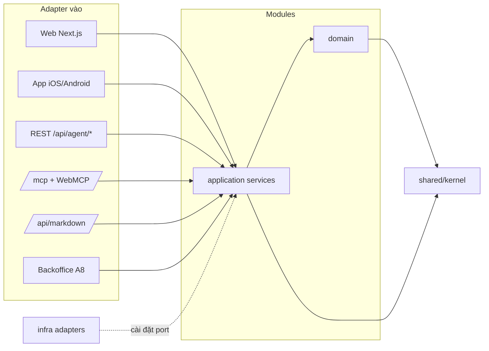
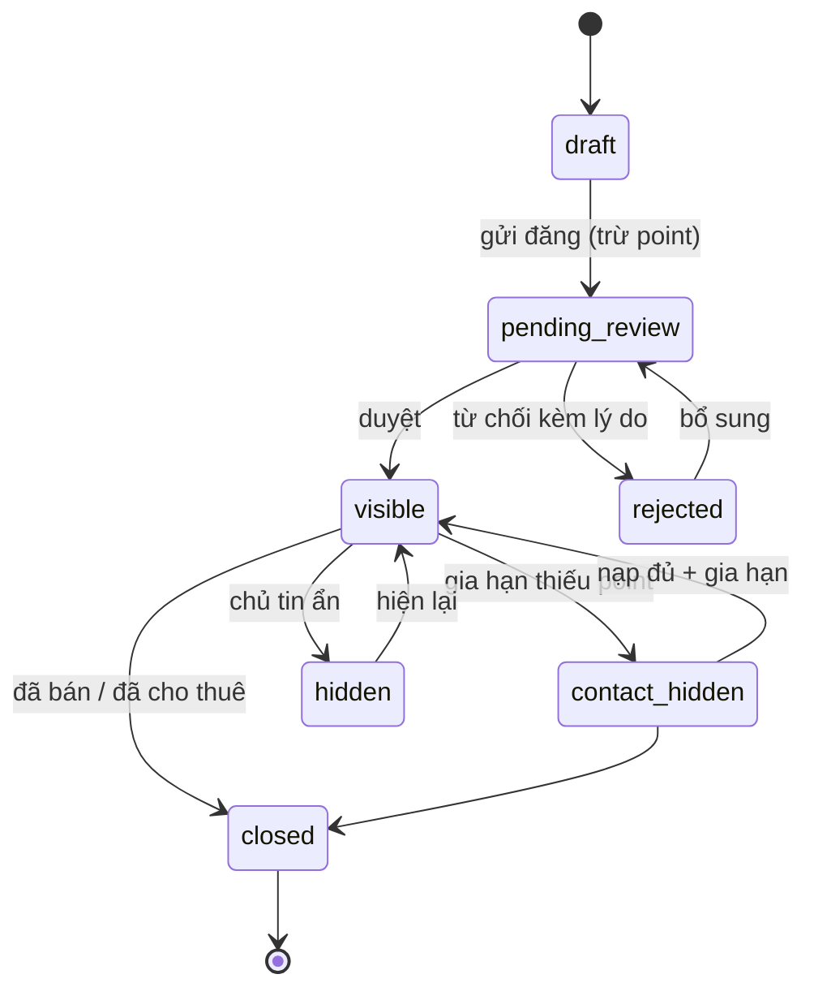
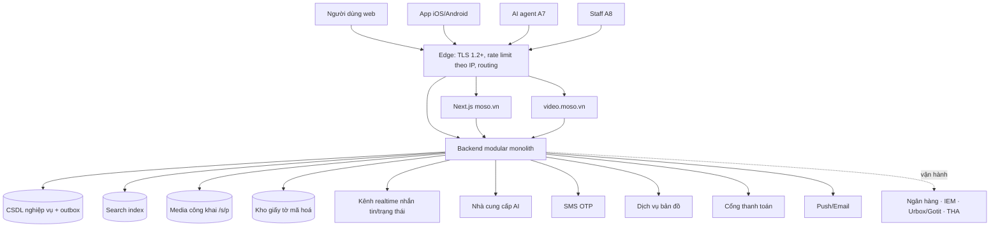
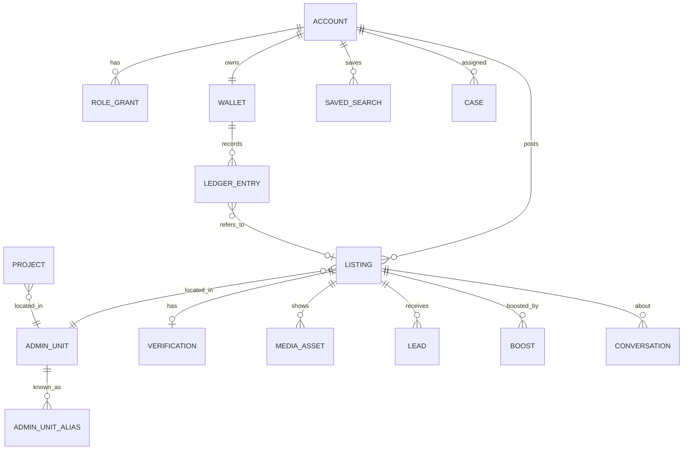
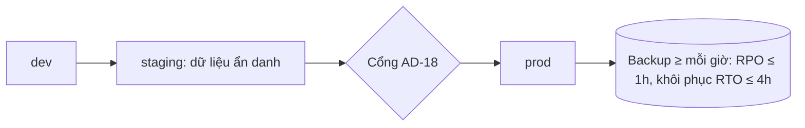

# Architecture Spine — MOSO.VN

> Hệ thống đã vận hành; spine được phân tích ngược từ bề mặt công khai (crawl 22/10/2026). `[ADOPTED]` = hiện trạng quan sát được trong corpus. `[ASSUMPTION]` = suy luận, cần người xác nhận. Mã F-xx/C-xx/Q-xx theo brief; FR-/NFR- theo SRS.

## Design Paradigm

**Modular monolith, hexagonal (ports & adapters)** `[ASSUMPTION]`. Mỗi module M1–M11 là một bounded context có domain + application service riêng. Mọi kênh (web Next.js, app mobile, REST agent, MCP, markdown, backoffice) là **adapter vào** gọi cùng application service. Hạ tầng (CSDL, search index, AI, SMS/OTP, bản đồ, thanh toán, e-voucher, kho file) là **adapter ra** sau port.

| Lớp | Chứa gì | Được phụ thuộc vào |
| --- | --- | --- |
| `channels/*` (adapter vào) | Trang Next.js, API app, `/api/agent/*`, `/mcp`, `/api/markdown`, WebMCP, backoffice | `modules/*/application` |
| `modules/<m>/application` | Use case, lệnh, truy vấn, chính sách | `domain` của chính module, port của module khác |
| `modules/<m>/domain` | Thực thể, state machine, quy tắc giá/point | `shared/kernel` |
| `infra/*` (adapter ra) | Repo CSDL, index, nhà cung cấp AI/SMS/map/payment/voucher | cài đặt port |
| `shared/kernel` | Money, PointAmount, AdminUnitId, PhoneE164, SearchFilter, event envelope | không gì |

Luật phụ thuộc: mũi tên chỉ đi một chiều. Kênh không gọi nhau, không gọi `infra`. Module chỉ gọi module khác qua port/application service công khai của module đó, hoặc qua domain event (AD-12); không đọc bảng của module khác.

## Invariants & Rules

### AD-1 — Một backend, nhiều kênh là adapter mỏng

- **Binds:** all; FR-41, FR-42–FR-45
- **Prevents:** web, app, agent API, MCP mỗi bên cài lại quy tắc nghiệp vụ (lọc, giá/m², dedup lead, Ẩn số nhà) rồi lệch nhau.
- **Rule:** Mọi quy tắc nghiệp vụ nằm trong `modules/*`. Một adapter chỉ được: parse/validate input, gọi đúng một application service, định dạng output (HTML/JSON/markdown/JSON-RPC). Web và app dùng chung tài khoản, ví, tin đã lưu (FR-41) `[ASSUMPTION — SRS 2.5]`.

### AD-2 — Listing Read Model là cửa đọc tin duy nhất, đã áp chính sách hiển thị

- **Binds:** FR-01–FR-03, FR-06, FR-13, FR-18, FR-42–FR-45; NFR-09; F-22
- **Prevents:** một kênh (SEO, bản đồ, markdown, MCP) lộ số nhà hoặc số liên hệ vì tự đọc bản ghi thô.
- **Rule:** Mọi kênh đọc tin qua `ListingView(viewer)` của module Listing. Hàm này là nơi duy nhất quyết định: địa chỉ đầy đủ hay chỉ đường/phường, toạ độ thật hay làm mờ (bán kính theo Q-14, tạm ≥ 200 m), số liên hệ hiện hay ẩn (C-01). Không adapter nào truy cập trường địa chỉ/toạ độ/SĐT thô. Lượt mở địa chỉ đầy đủ được ghi log cho chủ tin (FR-18).

### AD-3 — Sổ cái MOSO Points append-only, một chủ sở hữu

- **Binds:** FR-12–FR-14, FR-18, FR-20–FR-22, FR-29; NFR-11; C-01, C-02, C-03
- **Prevents:** hai module cùng sửa số dư; cộng point hai lần do callback lặp; lịch sử không đối soát được.
- **Rule:** Module Points là chủ duy nhất của ví. Số dư = tổng các bút toán, không có cột số dư sửa trực tiếp. Module khác yêu cầu `charge/credit(account, amount, reason, refType, refId, idempotencyKey)`; mỗi bút toán lưu lý do, tham chiếu, số dư trước/sau (FR-20). Khoá idempotent bắt buộc: callback nạp = mã giao dịch cổng thanh toán; gia hạn = `listingId + kỳ`; thưởng một lần = `userId + rewardCode`; điểm danh = `userId + ngày (Asia/Ho_Chi_Minh)`. Bảng giá (5/8/5 point, gói đẩy tin) là cấu hình do Points sở hữu, đọc tại thời điểm trừ.

### AD-4 — Vòng đời tin là state machine của module Listing

- **Binds:** FR-12, FR-13, FR-14, FR-17, FR-25; C-01
- **Prevents:** module khác tự đặt cờ "đã bán"/"ẩn" khiến tin vẫn còn trong tìm kiếm, feed video hoặc API.
- **Rule:** Trạng thái tin chỉ đổi qua lệnh của module Listing theo sơ đồ dưới; mỗi chuyển trạng thái phát event (AD-12). Hết chu kỳ 30 ngày: Listing gọi Points trừ phí; thất bại → `contact_hidden`, không gỡ tin (C-01).

### AD-5 — Trạng thái xác thực ARV thuộc module Verification

- **Binds:** FR-01, FR-12, FR-17, FR-24; NFR-10; F-21
- **Prevents:** badge "Xác thực", bộ lọc "Tin xác thực" và mức giá 5/8 point dựa trên các nguồn sự thật khác nhau.
- **Rule:** Verification sở hữu `verificationStatus` (none/pending/verified/rejected) cùng lý do từ chối. Badge, lọc và bảng giá đều đọc trạng thái này qua port; không module nào tự lưu bản sao có thể sửa. Tin chưa xác thực vẫn được hiển thị, không có badge `[ADOPTED — hiện trạng 8 point; chờ Q-01]`.

### AD-6 — Một Lead service cho mọi kênh tạo yêu cầu

- **Binds:** FR-10, FR-30, FR-44; NFR-08; C-06; F-12, F-13
- **Prevents:** form web và `/api/agent/contact`/`request_contact` khử trùng khác nhau hoặc trả thông điệp khác nhau.
- **Rule:** Mọi lead tạo qua `Leads.request(name, phone, listingId, intent, source)`. Khoá trùng = `PhoneE164 + listingId` trong 24 giờ trượt → trả lead cũ với `duplicated: true` `[ADOPTED]`. SĐT phải hợp lệ định dạng VN. Trạng thái khởi tạo luôn `pending`; thông điệp phản hồi là "đã gửi yêu cầu", không bao giờ mang nghĩa "đã chốt lịch" `[ADOPTED — C-06]`. Lead gắn tin của môi giới tự vào CRM của môi giới đó (FR-30) qua event `leads.created`. `source` ghi kênh (web/app/api/mcp) để đo NFR-08.

### AD-7 — Registry đơn vị hành chính với alias sáp nhập 2025

- **Binds:** FR-01, FR-02, FR-04, FR-38, FR-43; C-08
- **Prevents:** tìm theo tên cũ ra kết quả khác tên mới; báo cáo cung và tìm kiếm đếm theo hai bộ địa giới khác nhau.
- **Rule:** Mọi địa danh phân giải qua một registry `AdminUnitId` có alias trước/sau sáp nhập. Tin lưu `AdminUnitId` chuẩn + chuỗi địa chỉ gốc như người đăng nhập. Tìm kiếm, slug SEO, API/MCP đều so khớp qua registry, không so chuỗi. Báo cáo cung ghi chú đếm theo địa chỉ cũ (FR-38) `[ADOPTED — C-08]`.

### AD-8 — Ngữ nghĩa giá và tiền

- **Binds:** FR-01, FR-07, FR-20, FR-32, FR-33, FR-36, FR-43; NFR-06, NFR-11; C-02, C-07
- **Prevents:** chỗ chia giá/m² theo diện tích sàn, chỗ theo diện tích đất; lọc dự án theo giá/m² thay vì giá tổng căn; sai số float trong tiền.
- **Rule:** Tiền là số nguyên VND; point là số nguyên (1 point = 1.000đ, đã gồm VAT). `price` luôn là giá tổng căn. Giá/m² không lưu, luôn suy ra bằng một hàm duy nhất trong `shared/kernel` = `price ÷ landArea` `[ADOPTED — C-07]`. Bộ lọc `minPrice/maxPrice` và `minUnitPrice/maxUnitPrice` của dự án đều là giá tổng căn.

### AD-9 — SearchFilter là hợp đồng tìm kiếm chung

- **Binds:** FR-01–FR-05, FR-07, FR-24, FR-42, FR-43
- **Prevents:** bộ lọc web, slug SEO, AI ngôn ngữ tự nhiên, lưu tìm kiếm và API mỗi bên một schema, khiến cảnh báo tìm kiếm không khớp kết quả.
- **Rule:** Một kiểu `SearchFilter` trong `shared/kernel` (type, propertyType, location: AdminUnitId[] | polygon, giá, diện tích, PN, verifiedOnly, hasVideo, query). Slug SEO ánh xạ tĩnh sang `SearchFilter`; slug không có ánh xạ → HTTP 404 (FR-02). AI NL (FR-04) chỉ được sinh ra `SearchFilter`, địa danh vào `location`, không vào `query` (C-07); không suy ra được thì rơi về `query` từ khoá. Lưu tìm kiếm (FR-05) lưu chính `SearchFilter`. API/MCP map tham số 1:1 sang `SearchFilter`; giới hạn `limit ≤ 20` áp tại application service, không tại adapter.

### AD-10 — Lớp agent: REST, MCP, WebMCP, markdown chung handler, OpenAPI là hợp đồng

- **Binds:** FR-42–FR-45; NFR-04, NFR-08; C-05, C-06, C-12; F-57–F-62
- **Prevents:** tool MCP và endpoint REST trả dữ liệu/lỗi khác nhau; OpenAPI lệch khỏi code; rate limit mỗi chỗ một kiểu.
- **Rule:** Mỗi tool MCP (`search_listings`, `compare_listings`, `read_page`, `search_projects`, `search_agents`, `request_contact`) gọi đúng application service mà endpoint `/api/agent/*` tương ứng gọi `[ADOPTED — bề mặt hiện có]`. `/api/openapi.json` (OpenAPI 3.1) là hợp đồng; CI kiểm tra hợp lệ và khớp route (FR-45). `request_contact`/`contact` là thao tác ghi duy nhất của lớp agent và đi qua AD-6. Rate limit áp tại edge theo IP + nhóm endpoint: search/projects/agents 60, compare/markdown 30, contact 10 req/phút; vượt → 429 + `Retry-After`; MCP trả lỗi JSON-RPC kèm thời gian thử lại `[ADOPTED — C-05]`. Markdown (`Accept: text/markdown` hoặc `/api/markdown`) render từ cùng read model (AD-2), không từ HTML đã render. Xác thực agent: chưa quyết (Q-10).

### AD-11 — AI chỉ tạo bản nháp, người commit

- **Binds:** FR-04, FR-12, FR-15, FR-19, FR-30, FR-37; NFR-03
- **Prevents:** AI ghi đè nội dung người đăng đã sửa; nội dung biên tập AI xuất bản không qua duyệt; mỗi module gọi nhà cung cấp AI theo cách riêng.
- **Rule:** Mọi gọi mô hình AI qua một port `AiPort` (sinh văn bản, phân tích câu → SearchFilter, xử lý ảnh). Đầu ra AI lưu là `draft` gắn `aiGenerated: true`; chỉ thao tác của người (chủ tin, biên tập viên) chuyển sang nội dung chính thức. Trường người dùng đã sửa đánh dấu `userEdited` và AI không được ghi lên (FR-12). Nội dung biên tập (tin tức, báo cáo) không thể xuất bản khi chưa có biên tập viên duyệt (FR-19). Đầu vào tra phong thủy (SĐT, biển số) không lưu thành lead (FR-37) `[ASSUMPTION]`.

### AD-12 — Domain event qua outbox cho mọi hiệu ứng phụ liên module

- **Binds:** FR-05, FR-06, FR-10, FR-13, FR-16, FR-26, FR-27, FR-28, FR-30, FR-31, FR-38
- **Prevents:** module gọi đồng bộ chéo nhau để cập nhật index/feed/thông báo, làm mất cập nhật khi lỗi giữa chừng.
- **Rule:** Thay đổi trạng thái ghi event vào outbox trong cùng transaction với thay đổi. Tiêu thụ bất đồng bộ, idempotent theo `eventId`: search index, feed video (gỡ khi tin `closed`/`hidden` — FR-06), cảnh báo lưu tìm kiếm, thống kê tin, CRM, thông báo. Mục tiêu độ trễ: rời kết quả tìm kiếm ≤ 5 phút (FR-13), cảnh báo ≤ 15 phút (FR-05), thống kê ≤ 60 giây (FR-16), trạng thái Partner/vay ≤ 60 giây (FR-27, FR-31). Nhắn tin (FR-09, NFR-02 ≤ 2 giây) dùng kênh realtime riêng, không đi qua outbox.

### AD-13 — Công cụ tính là thư viện hàm thuần có test vector

- **Binds:** FR-32, FR-33, FR-34, FR-36, FR-37; NFR-06, NFR-12; C-09, C-10
- **Prevents:** công thức thuế/vay/yield cài lại ở web, app và tiện ích trình duyệt cho ra số khác nhau; thiếu tuyên bố miễn trừ.
- **Rule:** Mọi công cụ tính nằm trong một thư viện hàm thuần, không I/O, dùng chung cho mọi kênh (gồm tiện ích Chrome/Firefox của FR-33). Mỗi hàm có test vector trong repo (vd. 5 tỷ → TNCN 100 triệu, trước bạ 25 triệu; 2 tỷ, thuê 10 triệu/tháng → gross yield 6,0%). Mỗi kết quả trả về kèm `disclaimer` (C-09) và `legalBasis[]` (C-10); adapter không được bỏ hai trường này khi hiển thị. Bảng giá đất (FR-34) luôn kèm số quyết định + ngày hiệu lực; thiếu dữ liệu trả "chưa có dữ liệu", không trả 0.

### AD-14 — Một tài khoản, SĐT + OTP là định danh, vai trò là grant

- **Binds:** FR-05, FR-18, FR-23, FR-26, FR-28, FR-40, FR-41
- **Prevents:** môi giới/Partner/CTV thành tài khoản riêng với ví riêng; quyền xem địa chỉ đầy đủ hiểu khác nhau giữa kênh.
- **Rule:** Mỗi người là một `Account` định danh bằng `PhoneE164` đã xác minh OTP (khoá 15 phút sau 5 lần sai — FR-23 `[ASSUMPTION]`). Vai trò (user, broker, partner_individual, partner_business, ctv, staff) là grant trên cùng tài khoản, có trạng thái duyệt; một ví point mỗi tài khoản. "Khách đủ quyền xem địa chỉ" = SĐT đã xác minh OTP + có lead với tin đó `[ASSUMPTION — chờ Q-05]`; điều kiện này chỉ được đánh giá trong `ListingView` (AD-2). Mọi thao tác của staff ghi audit (ai, lúc nào, đối tượng, trước/sau).

### AD-15 — Giấy tờ pháp lý và dữ liệu cá nhân tách khỏi media công khai

- **Binds:** FR-17, FR-23, FR-29, FR-40; NFR-07; C-11; F-56
- **Prevents:** sổ đỏ/giấy tờ bị phục vụ qua đường dẫn media công khai; xoá tài khoản bỏ sót dữ liệu cá nhân hoặc xoá mất dữ liệu luật bắt buộc lưu.
- **Rule:** Giấy tờ pháp lý, chứng chỉ, MST lưu ở kho riêng mã hoá AES-256, truy cập qua URL ký ngắn hạn cho staff; không bao giờ qua đường dẫn media công khai `/s/p/*`. Xoá tài khoản: gỡ tin ngay, xoá/ẩn danh dữ liệu cá nhân ≤ 30 ngày `[ASSUMPTION — Q-15]`; dữ liệu thuộc diện cơ quan tư pháp có thể yêu cầu (C-11) chuyển sang vùng lưu giữ pháp lý thay vì xoá.

### AD-16 — Bước duyệt thủ công là Case do module gốc sở hữu

- **Binds:** FR-08, FR-10, FR-17, FR-23, FR-26, FR-28, FR-29, FR-31; NFR-10
- **Prevents:** backoffice tự sửa bảng nghiệp vụ; SLA (2 giờ Partner, < 30 phút vay, ≤ 24 giờ xác thực) đo mỗi nơi một kiểu.
- **Rule:** Mỗi bước người duyệt (xác thực tin, duyệt môi giới/Partner, xác nhận lịch xem, hồ sơ vay, nguồn CTV, chứng chỉ, Signature) là một `Case` có `status`, `assignee`, `createdAt`, `slaDueAt`, `resolvedAt`, do module gốc sở hữu. Backoffice là adapter vào (AD-1), chỉ gọi lệnh của module. Kết quả có tác động point (vd. +100 khi duyệt chứng chỉ — FR-29) đi qua AD-3 với khoá idempotent theo `caseId`. Tích hợp ngân hàng/IEM/Urbox-Gotit ban đầu là bước vận hành trong Case, chưa phải API `[ASSUMPTION — SRS 2.5]`.

### AD-17 — Một pipeline media cho mọi ảnh/video tin

- **Binds:** FR-06, FR-12, FR-15; C-04
- **Prevents:** ảnh vào từ form đăng tin và từ công cụ xoá watermark áp giới hạn/định dạng khác nhau; mất phiên bản trước khi xử lý.
- **Rule:** Mọi upload qua một module Media: kiểm ≤ 20 ảnh/lần, ≤ 10 MB/ảnh, PNG/JPG/WEBP, yêu cầu đăng nhập (C-04); lưu bản gốc bất biến; mỗi lần xoá watermark tạo phiên bản mới, có thể khôi phục (FR-15); đóng watermark MOSO khi xuất bản `[ADOPTED — tên file moso-wm-v3, dewatermark]`. Ảnh công khai phục vụ dưới `/s/p/*`, tối ưu qua Next.js image `[ADOPTED]`.

### AD-18 — Cổng phát hành bắt buộc

- **Binds:** NFR-06, NFR-09, NFR-12, FR-45
- **Prevents:** một bản phát hành làm lộ số nhà ở một kênh, lệch OpenAPI hoặc sai công thức mà không ai biết.
- **Rule:** Pipeline phát hành chặn nếu một trong các kiểm tra trượt: (1) test rò rỉ địa chỉ — tin bật Ẩn số nhà gọi qua web HTML, SEO, bản đồ, app API, REST agent, MCP, markdown đều không chứa số nhà/toạ độ thật; (2) OpenAPI 3.1 hợp lệ và khớp route; (3) toàn bộ test vector AD-13 và AD-8 qua.

## Consistency Conventions

| Concern | Convention |
| --- | --- |
| Ngôn ngữ | UI, thông báo, lỗi hiển thị: vi-VN mặc định, en cho trang chính (C-12). Mã nguồn, tên định danh, tên event: tiếng Anh. |
| Đặt tên | Module `listing, search, verification, points, leads, messaging, brokers, partners, finance, tools, content, accounts, agent-gateway, media`. Event `<module>.<quá khứ>` (vd. `listing.closed`, `points.charged`, `leads.created`). Slug URL tiếng Việt không dấu, gạch nối `[ADOPTED]`. |
| ID | ID nội bộ dạng opaque string; URL công khai dùng slug + hậu tố ngắn (vd. `/the-peak-garden-ktme93`) `[ADOPTED]`; API agent nhận slug/URL tin (`compare?urls=`) `[ADOPTED]`. |
| Thời gian | Lưu UTC ISO-8601; mọi quy tắc theo "ngày" (điểm danh, 5 lượt/ngày, 3 lượt đẩy/ngày, bảng xếp hạng tháng) tính theo `Asia/Ho_Chi_Minh`. |
| Tiền / số | VND và point là số nguyên (AD-8). Diện tích m² số thập phân 2 chữ số. |
| SĐT | Chuẩn hoá E.164 (`+84…`) ngay tại adapter trước khi vào module. |
| Lỗi API | JSON `{ error: { code, message } }` + HTTP status chuẩn; 400 tham số sai (vd. compare 1 hoặc 6 tin), 404 slug không tồn tại, 429 + `Retry-After`. MCP dùng mã lỗi JSON-RPC với cùng `code`. |
| Định dạng output agent | Mọi endpoint agent hỗ trợ `format=json|markdown` `[ADOPTED]`. |
| Idempotency | Mọi lệnh có thể bị gửi lặp (callback, thưởng, gia hạn, tạo lead) mang khoá idempotent (AD-3, AD-6). |
| Tuyên bố | Kết quả công cụ luôn có `disclaimer`; nội dung giải trí (FR-37) ghi "mang tính giải trí/tham khảo". |
| Logging & audit | Log có `requestId`, `channel`, `accountId?`; không log SĐT, địa chỉ đầy đủ, giấy tờ ở dạng rõ. Thao tác staff ghi audit (AD-14). |
| Config | Bảng giá point, gói đẩy tin, ngưỡng (DTI 50%, MUA/CÂN NHẮC/CHỜ), rate limit là cấu hình có phiên bản, không hard-code trong adapter. |

## Stack

| Name | Version |
| --- | --- |
| Next.js (web SSR/SEO, tối ưu ảnh) `[ADOPTED]` | không quan sát được — chốt theo repo |
| MCP server, transport Streamable HTTP, JSON-RPC 2.0 `[ADOPTED]` | JSON-RPC 2.0; revision MCP spec chốt theo repo |
| OpenAPI (hợp đồng API agent) `[ADOPTED]` | 3.1 |
| WebMCP tool manifest `/.well-known/webmcp/tools.json` `[ADOPTED]` | theo manifest hiện có |
| App mobile iOS/Android `[ADOPTED]` | iOS ≥ 16, Android ≥ 10 (NFR-14) |

## Structural Seed

### Container & tích hợp ngoài

### Thực thể lõi

### Môi trường & vận hành `[ASSUMPTION]`

- Mục tiêu uptime ≥ 99,5%/tháng cho web, app API, API agent (NFR-05).
- Một vùng triển khai chính gần người dùng VN; nhà cung cấp hạ tầng chưa quan sát được (xem Deferred).

## Capability → Architecture Map

| Capability / Area | Lives in | Governed by |
| --- | --- | --- |
| E1 Tìm kiếm & khám phá (FR-01–FR-08) | `search`, `listing`, `content` (SEO slug), `channels/web` | AD-2, AD-7, AD-8, AD-9, AD-12 |
| E2 Liên hệ & giao dịch (FR-09–FR-11) | `leads`, `messaging`, `content` | AD-6, AD-12, AD-16 |
| E3 Đăng tin & quản lý tin (FR-12–FR-16) | `listing`, `media`, `points` | AD-3, AD-4, AD-11, AD-12, AD-17 |
| E4 Xác thực & bảo vệ tin (FR-17–FR-19) | `verification`, `listing` (ListingView), `content` | AD-2, AD-5, AD-11, AD-15, AD-16, AD-18 |
| E5 Points & thanh toán (FR-20, FR-21) | `points` | AD-3, AD-8 |
| FR-22 Trò chơi đoán giá | `content` (game) → `points` | AD-3, AD-8 |
| E6 Môi giới & đối tác (FR-23–FR-30) | `brokers`, `partners`, `accounts` | AD-3, AD-6, AD-12, AD-14, AD-16 |
| E7 Tài chính & vay (FR-31, FR-32) | `finance`, `tools` | AD-12, AD-13, AD-16 |
| E8 Công cụ pháp lý/thuế/đầu tư (FR-33–FR-37) | `tools` | AD-11, AD-13 |
| E9 Nội dung & dữ liệu thị trường (FR-38, FR-39) | `content`, `search` (thống kê) | AD-7, AD-11, AD-12 |
| E11 Tài khoản & app (FR-40, FR-41) | `accounts`, `channels/app` | AD-1, AD-14, AD-15 |
| E10 Nền tảng AI agent (FR-42–FR-45) | `agent-gateway` (adapter) | AD-1, AD-2, AD-6, AD-9, AD-10, AD-18 |
| FR-35 Check quy hoạch (Won't) | `tools` — chỉ trang "Sắp ra mắt" | — |

## Deferred

| Mục | Vì sao chờ được / điều kiện xem lại |
| --- | --- |
| Cơ chế xác thực agent (Q-10) | Hiện trạng không xác thực + rate limit IP đủ cho đọc; **chặn** khi spam lead qua API > 5% (NFR-08) hoặc mở thao tác ghi mới. |
| Quy tắc tin chưa xác thực (Q-01) | AD-5 giữ hiện trạng; **chặn** nếu MOSO chọn "xác thực trước khi hiển thị" — khi đó thêm chuyển trạng thái bắt buộc trong AD-4. |
| Định nghĩa "khách đã xác thực" + Ẩn số nhà mặc định/add-on (Q-05) | Mọi đánh giá dồn về `ListingView` (AD-2) nên đổi định nghĩa không lan ra kênh; **chặn** UX E4. |
| Nhà cung cấp cloud, CSDL, search engine, hàng đợi | Không quan sát được; chốt theo repo. Ràng buộc: hỗ trợ transaction + outbox (AD-12), truy vấn đa giác (FR-03). |
| Công nghệ app mobile, kênh realtime | Không quan sát được; chỉ ràng buộc NFR-02 và AD-1. |
| Nhà cung cấp AI, SMS OTP, bản đồ, thanh toán (Q-08), e-voucher | Đều sau port (AD-11, AD-3); chọn khi triển khai epic tương ứng. |
| Kênh thông báo (Q-16) | Sau port `Notify`; không ảnh hưởng hợp đồng giữa module. |
| Công thức MOSO Score (Q-09), ngưỡng MUA/CHỜ (Q-13), bán kính làm mờ (Q-14) | Là cấu hình/hàm trong module chủ; đổi không phá ranh giới. |
| AVM thực sự (Q-06) | Hiện tại định giá = giá rao/m² khu vực ±10% trong `tools`; AVM sẽ là adapter AI mới sau `AiPort`. |
| Đồng bộ giỏ hàng Partner doanh nghiệp (FR-26) | Cơ chế (pull feed/push API) chọn khi làm E6; phải ghi qua lệnh của `listing`, không ghi thẳng. |
| Phân tách thành service riêng | Chỉ khi một module có tải hoặc nhịp phát hành khác hẳn; ranh giới module đã sẵn (AD-1). |
| Quan sát hệ thống (metrics, tracing, alerting) chi tiết | Ngoài tối thiểu `requestId`/log ở Conventions; chốt cùng nhà cung cấp hạ tầng. |
